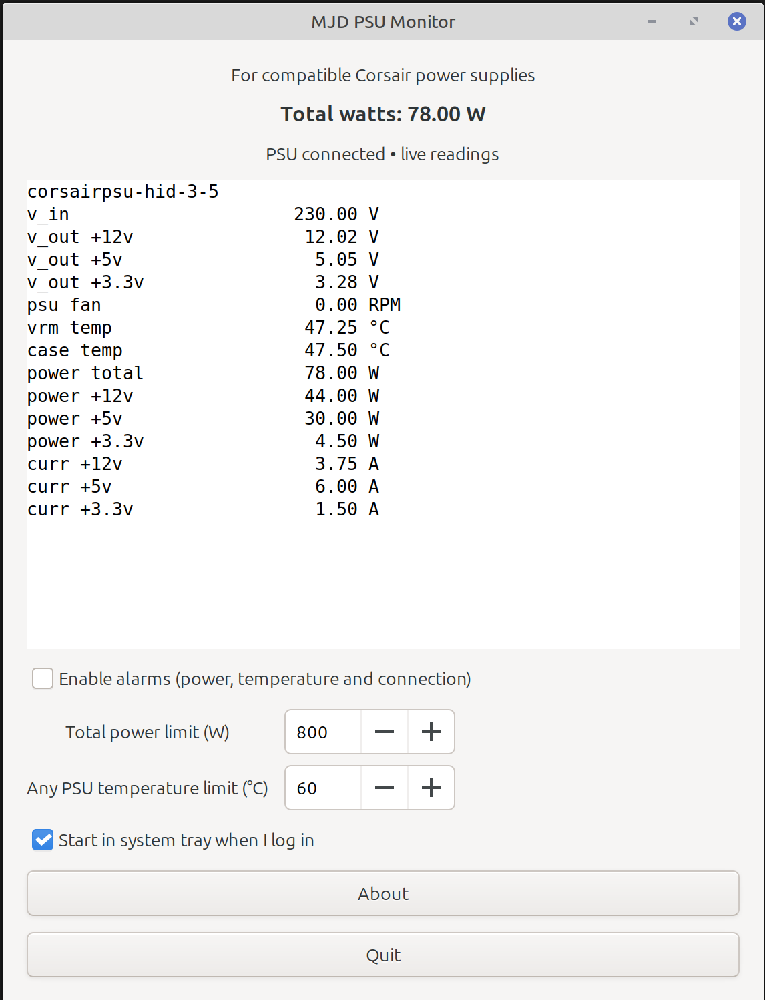

# MJD PSU Monitor



[Download the latest release](https://github.com/Tabat99/mjd-psu-monitor/releases/latest)

**An independent Linux desktop monitor for compatible Corsair power supplies.**

MJD PSU Monitor displays PSU telemetry in a GTK interface, with system tray
monitoring, configurable alarms and optional startup at desktop login. It is
written in C and built with CMake, using `libsensors` and the Linux
`corsair-psu` driver to read the hardware.


This project is not developed, sponsored, endorsed by, or affiliated with CORSAIR.

## Features

- Total power, rail voltages and currents, PSU temperatures and fan speed.
- Live updates and device rediscovery every two seconds.
- System tray icon with alarm and disconnected badges.
- Configurable power and temperature limits, plus lost-telemetry alerts.
- Desktop notifications and a beep when new alarm conditions occur.
- Automatic recovery when PSU USB telemetry becomes available again.
- Optional startup in the tray after desktop login.
- One instance per desktop session.
- X11/XLibre and native Wayland tray implementations.
- Scripts for clean builds, Debian packages and AppImages.

Available readings depend on the PSU model and kernel driver. The application
reads telemetry only; it does not change PSU settings or control its fan.

## Hardware and platform requirements

The project targets **Linux Mint**, with Debian/Ubuntu package preparation
scripts. The initial hardware reference is a Corsair HX1000i. Other PSUs exposed
by the `corsair-psu` driver may work, but have not been verified by this project.

You need:

- A supported PSU connected to the motherboard through its USB monitoring cable.
- A kernel with a working `corsair-psu` driver.
- A graphical desktop session with D-Bus.
- A compatible tray host for background tray operation.

Before building, check that `sensors` shows a device such as
`corsairpsu-hid-3-5`. Its address may differ on your system.

```bash
sudo apt update
sudo apt install lm-sensors
sudo modprobe corsair-psu
sensors
```

See the [Linux kernel driver documentation](https://docs.kernel.org/hwmon/corsair-psu.html)
for driver capabilities and supported devices. Installing `lm-sensors` alone
does not establish a working USB connection or add missing kernel support.

## Build and run

Download or clone this repository, open a terminal in its root folder, then:

```bash
bash prep.sh
bash build.sh
./build/mjd-psu-monitor
```

`prep.sh` checks for missing packages and installs them with `apt-get`, using
`sudo` when needed. It includes the C toolchain, CMake, pkg-config, GTK3,
libsensors and Ayatana AppIndicator development packages.

**Every run of `build.sh` deletes the project's `build/` directory** before
configuring and compiling. Quit the running application before rebuilding.
Run the application as your normal desktop user.

## Build installers

Prepare the packaging dependencies and build both formats:

```bash
bash prep.sh --packaging
bash installers.sh
```

To build only one format:

```bash
bash installers.sh deb
bash installers.sh appimage
```

Packages are written to `dist/`. Their filenames contain the version from
`version.ini` and the build architecture. The script builds packages; it does
not install them.

### Debian package

The `.deb` includes a desktop menu launcher and icon. Runtime library
dependencies are calculated using `dpkg-shlibdeps`.

For version 1.3.1 on an amd64 system:

```bash
sudo apt install ./dist/mjd-psu-monitor_1.3.1_amd64.deb
```

Use the actual filename generated on your machine. To uninstall:

```bash
sudo apt remove mjd-psu-monitor
```

### AppImage

For version 1.3.1 on an x86_64 system:

```bash
chmod +x dist/MJD-PSU-Monitor-1.3.1-x86_64.AppImage
./dist/MJD-PSU-Monitor-1.3.1-x86_64.AppImage
```

Keep the AppImage at a permanent location before enabling login startup.
If FUSE is unavailable, try launching with `--appimage-extract-and-run`.

The packaging script supports x86_64 and aarch64. It downloads linuxdeploy and
its GTK plugin from upstream GitHub into `.packaging-tools/` on first use.
These are executable third-party tools; internet access is required. Cached
tools are reused. Current upstream continuous/master versions are used, so
builds are not pinned or reproducible.

The AppImage bundles libraries and GTK resources but still needs compatible
host graphics, desktop services and kernel hardware support. Build on the
oldest distribution release you intend to support, then test on each target.

## Using the tray

The tray uses the project icon, with a yellow badge for active alarms or a red
badge for unavailable PSU telemetry when alarms are not active.

| Display backend | Tray implementation | Open the window |
| --- | --- | --- |
| X11 / XLibre | Traditional GTK status icon | Click the icon, or use its menu |
| Native Wayland | Ayatana AppIndicator / StatusNotifierItem | Select **Show monitor** from the tray menu |

GTK selects the display backend for the current session. Running through
XWayland uses the X11 path. Some Wayland desktops require an indicator extension
or panel plugin; this application does not install one.

Closing the window keeps monitoring in the tray when a tray is available.
Otherwise, closing exits. Use **Quit** to exit fully. If the tray disappears
while the window is hidden, the window reappears.

## Alarms

Enable alarms in the main window and set the power and temperature limits.
Alarms cover total power, either PSU temperature, missing PSU telemetry and
failed sensor reads. Settings persist across restarts.

Alarms start **disabled**. The initial limits of **800 W** and **60 °C** are
editable examples, not manufacturer safety ratings. A power alarm clears 5 W
below its limit; a temperature alarm clears 2 °C below its limit to reduce
repeated alerts near the threshold.

New conditions produce a visible warning, desktop notification and beep.
Notifications are not repeated every update. Sound and notification delivery
depend on desktop settings. Monitoring requires the application to be running;
it is not a replacement for the PSU's built-in protection.

The total-watts display uses the driver's `power1` reading rather than adding
rail readings. If multiple compatible PSUs are detected, their reported totals
are summed and labelled. The app does not calculate AC input power or efficiency.

## Start at login

Tick **Start in system tray when I log in** to enable startup. Untick it to disable.
This applies after graphical desktop login, not before login at system boot.

The application waits up to five seconds for a tray host. If none is available,
it shows its window. You can also request this behaviour manually:

```bash
./build/mjd-psu-monitor --start-in-tray
```

Login startup points to the current executable, or the outer AppImage. If you
move it or switch package formats, untick and tick the option again from the
copy you intend to use. Disable startup before removing the executable.

## Configuration and version

| File | Purpose |
| --- | --- |
| `~/.config/mjd-psu-monitor/settings.ini` | Saved alarm settings |
| `~/.config/autostart/mjd-psu-monitor.desktop` | Optional login startup entry |
| `version.ini` in the repository | Build-time application version |

User configuration paths respect `XDG_CONFIG_HOME`.

`version.ini` contains only a version such as `1.3.1`, using
`major.minor.patch`. CMake validates and embeds it during the build. The MIT
license and app icon are embedded too, so their source files are not required
beside the executable. The About window displays the version and full license.

## Troubleshooting

**CMake cannot find `ayatana-appindicator3-0.1`**

```bash
sudo apt install libayatana-appindicator3-dev
bash build.sh
```

**PSU not detected or readings unavailable**

Check the USB monitoring cable, PSU power and driver, then run:

```bash
sudo modprobe corsair-psu
sensors
uname -r
```

The application cannot distinguish an unplugged cable from missing driver
support, an unpowered PSU or another telemetry fault. Reconnection is checked
automatically; failed readings are not displayed as old values.

**No tray icon on Wayland**

Check whether your desktop provides a StatusNotifier/AppIndicator host. The
window remains usable without one. Tray menu behaviour varies by desktop.

**Testing a specific display backend**

Quit any running copy first, then run the appropriate command within a desktop
session that supports that backend:

```bash
GDK_BACKEND=x11 ./build/mjd-psu-monitor
GDK_BACKEND=wayland ./build/mjd-psu-monitor
```

## Project status and contributing

This is an early project. Shell syntax and archive checks have been performed;
full compilation, packaging and desktop/hardware integration have not been
verified in the project creation environment. XLibre compatibility follows its
X11 protocol support, but has not been tested here. Sensor reads are synchronous,
so a slow kernel USB timeout may temporarily pause the interface.

Bug reports and pull requests are welcome. Include the app version, distribution,
kernel version, PSU model, desktop/session type, installation format and relevant
error output. Useful checks include readings against `sensors`, tray reopening,
alarm recovery, USB reconnection and login startup.

When upgrading from versions before the naming update, quit the old copy first.
Alarm settings now use the `mjd-psu-monitor` configuration directory. Re-enter
your limits and update login startup to point to the new executable.

## License and trademarks

Copyright © mjd 2026. Application source code is licensed under the
[MIT License](LICENSE). Bundled third-party components retain their own licenses;
review their notices and source-distribution obligations before redistributing
an AppImage.

This is independent software developed by mjd. It is not developed, sponsored,
endorsed by, or affiliated with CORSAIR.

CORSAIR is a registered trademark of its respective owner. Product names are
used solely to identify compatible hardware.
